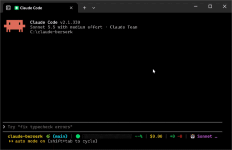

# berserk

Berserk uses the quota you have left before your window resets. It adjusts model and reasoning settings for the work you already have. Use it as a Claude Code plugin or as a terminal companion for Codex and GitHub Copilot CLI.



## Install in Claude Code

```
/plugin install berserk --marketplace NN---/agent-berserk
```

Local trial: `claude --plugin-dir ./agent-berserk`.

## Set up the terminal companion

Install Node.js 22.12 or later. From this checkout, install with npm and build:

```sh
npm ci
npm run build
```

The examples below assume you run them from this checkout. To work in another repository, change to that repository and use the absolute path to the built `dist/cli/main.js`.

### Codex

Put the Codex CLI on your PATH and sign in to your ChatGPT account with `codex login`. Berserk defaults to the weekly reset. Pass `5hour` when Codex reports a 5-hour quota window.

```sh
node dist/cli/main.js codex
node dist/cli/main.js codex smart 30m test
node dist/cli/main.js codex max week
```

### GitHub Copilot CLI

Sign in to your GitHub account in Copilot CLI. Berserk uses that sign-in with the runtime bundled in the Microsoft Copilot SDK. It defaults to the monthly reset for your reported chat or premium quota.

```sh
node dist/cli/main.js copilot
node dist/cli/main.js copilot smart month test
node dist/cli/main.js copilot max month
```

### Use the companion session

The companion is its own prompt. It starts in your terminal, and you type `/berserk` commands into it. This holds for both Codex and Copilot. Codex's own `$skill` syntax and Copilot's own slash commands do not apply, because Berserk is not a Codex skill or a Copilot extension.

Type `/berserk smart` to start, then enter your prompts in the same terminal. Use `/berserk status` to see usage and time left, `/berserk off` to restore normal routing, or `/exit` to close the session.

- Use `smart`, `advise`, or `max` to choose reasoning effort for each turn. Set a baseline model with `--model ID` and optionally a model for harder turns with `--heavy-model ID`.
- Pass a duration such as `30m` to set a deadline. Berserk checks available quotas between turns and ends at 98% reported use. Add `exact` to run for the specified duration regardless of quota.
- Add `test` to preview the window and usage without activating Berserk or running a prompt.
- Pass `--prompt "your task"` for one turn. Use an interactive session when you need to approve tool actions.

## Use in Claude Code

```
/berserk [smart|advise|max|fable|full] [week|month|5hour|10min|2 hours|2days|2weeks|2h up to 3h] [test]
/berserk status | off | help
```

Examples:

```
/berserk                    ask which mode, then run to the weekly reset
/berserk max                max mode until the weekly reset (the default window)
/berserk 5hour              until the 5-hour quota resets
/berserk month              until the monthly limit resets (30 days if none is reported)
/berserk 10min              up to 10 minutes (the default for any typed time)
/berserk 1day 3windows         up to 1 day, but stop after the third 5-hour quota window
/berserk 5days exact        the full 5 days, even past the weekly reset and 98% quota
/berserk 2days              two days (also 2weeks, 3 months)
/berserk 2 hours up to 3h   stop at 2 hours, or keep going to 3 hours if a turn is still running
/berserk test               dry run: shows what would happen, changes nothing
```

| Mode | Heavy steps | Routine steps |
| --- | --- | --- |
| `smart` (default) | Opus, high effort | Sonnet / Haiku |
| `advise` | Opus, only for the first step and after errors | Sonnet does everything else |
| `max` | Opus, xhigh | Sonnet |
| `fable` | Fable, high (opt-in, expensive) | Opus / Haiku |
| `full` | Fable, max effort, workflows and parallel agents; asks twice | Opus / Sonnet |

With no arguments it asks which mode. The window defaults to the weekly reset (`week`). Other windows are the monthly reset (`month`), the 5-hour reset (`5hour` or `window`), or a fixed time such as `10min`, `2 hours`, `2days`, `2weeks`, `3 months` (`h`, `d`, `w` shorthands work too). A typed time means "up to": berserk stops at that time, when the weekly quota renews, or at 98% quota, whichever comes first. Add `3windows` (or `3x5hour`) to also stop at the end of the third 5-hour quota window, counting the current one as the first. Add `exact` (`2h exact`) to run the full time whatever the quota does. With `2h up to 3h`, berserk ends at the soft time but waits for a running turn to finish, up to the hard cap. `test` shows the plan and changes nothing.

- The first step of each turn and any step after an error run on the heavy model. Steps after reads run on the fast one, steps after edits on the middle one.
- Berserk pushes harder when you are behind the time-elapsed pace and eases off when ahead.
- It stops at the end of the window, or when the quota it watches reaches 98%, and it will not start at 98% or more. A toast shows how much you burned.
- A status line and a band above the prompt show time left and quota used.
- Fable is never used unless you ask for `fable` or `full`.

While it runs, the status line flickers, shows a rage stage (Simmering, Growling, Raging, Frenzy, Blood-red, Ragnarok, VALHALLA) as you burn quota, and the band above the prompt shouts a changing battle cry.

Try `/berserk rage`, `odin`, `valhalla`, `bear`, `rest`, `ragnarok`, `thor`, `loki`, `freya`, `skol`, `coffee`, `42`.

## Caveats

- Quota figures come from your subscription's rate limits. On API billing the reset is unknown, so berserk runs 24 hours.
- Model routing only changes the model per step; it cannot make a turn cheaper than the model it picks.

## Develop

```sh
npm ci
npm run check
```

`check` runs the strict typecheck, ESLint, the Vitest unit tests, the plugin tests (`claude plugin test .`) and `claude plugin validate .`. See [check locally](docs/contributing/check-locally.md).

`hooks/logic.ts` holds the pure logic (tested in `logic.test.ts`); `hooks/register.tsx` wires it to the engine.

MIT licensed.
